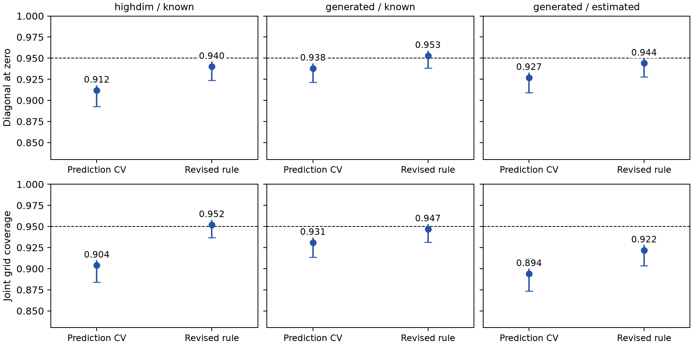
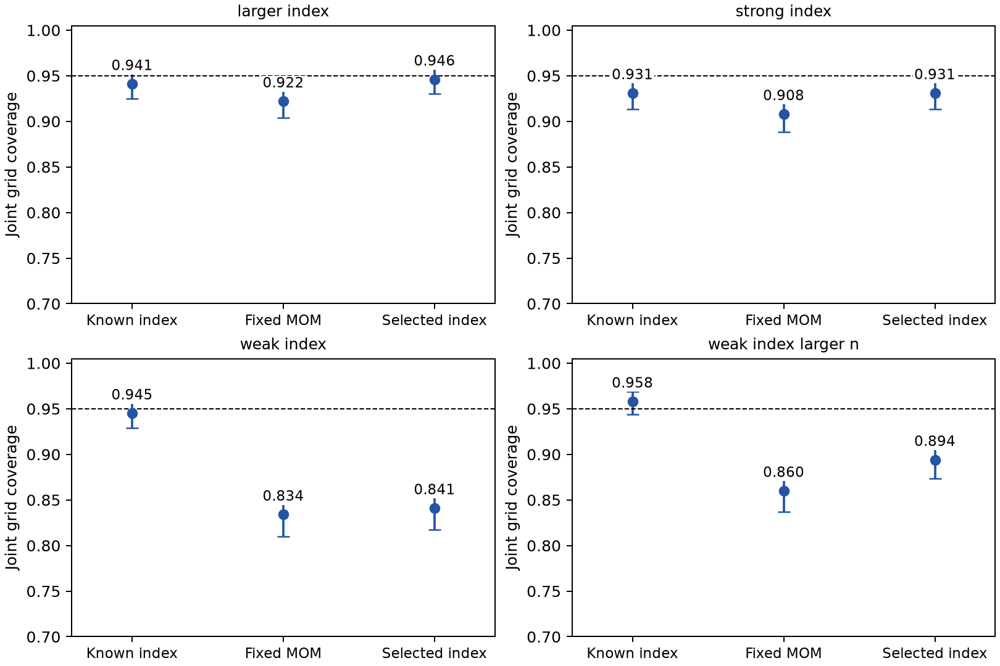

# Validation and findings

The module is implemented and tested. The latest diagonal/CV findings,
independent stress results, and first-stage confirmation are reported below. Coverage selection and paper-scale
validation remain an active numerical investigation. The large `paper.toml`
suite is prepared but has not been submitted: the exploratory results do not
yet justify declaring every inference variant satisfactory.

## Software validation

All numerical checks ran in Discovery Slurm allocations.

* Job `13382591`: 53 initial focused tests passed.
* Job `13382607`: the two-replication end-to-end smoke test completed; 496
  output rows, one expected shard and no duplicate result identities.
* Job `13382675`: all 1379 then-current package tests passed after restoring
  an extension directory omitted from the initial staging snapshot. The later
  generator check exposed a test-fixture dictionary type error. Both failed
  validation attempts and their causes remain recorded.
* Job `13382690`: 54 focused tests and 68 independent generator checks passed
  on Julia 1.13.2 and Julia 1.10.12.
* Job `13382773`: all 1388 final package tests passed on Julia 1.13.2,
  followed by 68 independent generator checks. On Julia 1.10.12, all 62 focused
  inference tests and 68 generator checks passed. This validates the final
  support-refit extension and fixed-window tuning implementation.

The tests include polynomial reproduction, an independent direct HC0
residual-product calculation, diagonal inference, all sparse pilots, one-step
algebra, exact reproduction of observation-multiplier critical values, support
refits, input failures, tuning and norm definitions. Generator checks include
analytic inverse identities, structural residual moments, deterministic seeds,
and the Gaussian/bump score identities. They do not prove coverage.

## Completed scout

Job `13382679` completed all 18 shards and 105000 output rows. Its six scenarios
use 30 replications each and common datasets across methods and tuning choices.
[The full scout table](../../experiments/single_index/results/scout/REPORT.md)
retains every method, including failures and adverse results. The reporting job
`13382691` produced summary tables, paired coverage comparisons and PDF figures.

The scout indicates that the default ACLIME inverse is not automatically a good
pilot for direct one-step inference. In the final-bandwidth scenario, with
nominal 95% joint coverage over three entries and 11 grid points, its observed
coverage was 43.3%, 16.7% and 6.7% as the final-bandwidth factor increased from
0.65 to 1 to 1.4. The matching ACLIME block construction covered 76.7% in these
three cases. These are exploratory 30-replication results, not final estimates.

For the penalty scenario, reducing the multiplier from 1.2 to 0.35 improved
ACLIME-block family coverage from 46.7% to 100%; scaled-lasso block coverage
increased from 80.0% to 96.7%. Widths also increased. The intervals and Wilson
bounds in the saved summaries must accompany any interpretation of these
small-sample Monte Carlo results. No optimal multiplier is inferred from them.

The poor direct ACLIME behavior motivates support refits and a closer check of
pilot scale. Its population one-step diagonal bias is quadratic and negative;
see [METHODS.md](METHODS.md). Multiplier resampling does not remove that bias.

## Completed larger studies

* Development: jobs `13382620` and recovery `13382838`; all 110 shards,
  693200 rows, 100–200 replications per scenario.
* Independent baseline confirmation: jobs `13382659` and recovery `13382839`;
  all 240 shards, 582400 rows, 200 replications per scenario.
* Refinement: jobs `13382776` and recovery `13382840`; all 140 shards,
  581200 rows, 200–300 replications per scenario.
* Assessment: job `13382956`; regenerated summaries and figures from saved
  outputs, checked nested-grid critical-value monotonicity, and wrote the
  [full assessment](../../experiments/single_index/results/assessment/ASSESSMENT.md).

All recovery jobs completed successfully. Final shards were reused, interrupted
partial files and original logs were preserved, and only missing shards were
rerun after the worker-memory scheduling repair. Aggregation checked all
expected shards and duplicate identities. The final reporter also checks the
expected pointwise-row count and restores failure-inclusive norm denominators
for early worker formats. No independent refitting audit is claimed.

The independent 200-replication block baseline at sample size 600 gave joint
coverage 93.0% for square-root-lasso block inversion, 92.0% for scaled-lasso
block inversion, 77.5% for ACLIME block inversion, and 31.5% for the direct
ACLIME one-step correction. The oracle covered 94.0%. Thus a default inverse
pilot is not automatically suitable for debiasing.

In the 300-replication support-refit baseline, scaled-lasso-refit block and
square-root-lasso-refit block both covered 95.0%; ACLIME-refit block covered
94.3%. With varying nuisance coefficients, these values were 94.0%, 93.0%,
and 90.7%, respectively. Refitting is promising but is not uniformly beneficial:
scaled-lasso-refit one-step family coverage was 83.0% and 82.0% in the two cases.

The corrected fixed-window CV selector gave 94.0% family coverage in 200 fresh
replications. At zero its diagonal, crossing-edge and null-edge pointwise
coverages were 94.5%, 93.0% and 92.0%. It is a prediction-based heuristic, not a
coverage-optimal rule. The high-dimensional fixed-baseline square-root-lasso
case covered only 88.5% jointly. These limitations prevent a general tuning
recommendation or a claim that the full suite is ready for an AoS paper.

Nested 21/41/81-point grids shared each dataset and multiplier stream. Across
200 replications there were no failed triples or critical-value monotonicity
violations. Increasing 41 to 81 points changed mean critical values by about
0.003 for the oracle/square-root-lasso methods and 0.012 for scaled-lasso-refit
block inversion. Family coverage changed by 0 to -0.5 percentage points.
This supports numerical grid stability in these cases, not continuum validity.

Sparse pilots and full one-step matrices serve different purposes. For example,
in the high-dimensional baseline the mean spectral error was 0.573 for the
scaled-lasso pilot and 4.433 for its full one-step matrix. Norm tables, lengths,
Wilson intervals and adverse findings are retained in the full assessment.

## Initial independent 1000-replication confirmation

Job `13383047` completed all 400 shards and 1554000 output rows. It used
1000 replications per scenario, 1999 multipliers and 21 grid points, with an
independent seed namespace. Its 32 CPUs and 64 GB were spread over two nodes.
The earlier single-node job `13383011` was cancelled before execution to improve
scheduling. Reporting job `13383088` completed; `13383160` corrected the wider-pilot
figure selection and clarified nominal versus selected tuning labels. No
simulation refits were needed for that reporting correction.

See the [full confirmation report](../../experiments/single_index/results/paper_confirmation/PAPER_CONFIRMATION.md).
The fixed-rule cases use a final bandwidth of 2.5*n^(-1/5), pilot bandwidth
1.6 times as large, and prespecified penalty multipliers 0.35 and 0.7.

| Method and multiplier | Constant nuisance, n=600, p=40 | Varying nuisance, n=1200, p=80 |
|---|---:|---:|
| Scaled-lasso-refit block, 0.7 | 95.7% | 95.0% |
| Scaled-lasso-refit block, 0.35 | 94.3% | 83.8% |
| ACLIME-refit block, 0.7 | 93.4% | 93.6% |
| ACLIME-refit block, 0.35 | 95.3% | 91.5% |
| Square-root-lasso block, 0.7 | 91.8% | 93.4% |
| Square-root-lasso block, 0.35 | 96.7% | 93.2% |

These are joint grid coverages at nominal 95%, not pointwise diagonal
coverages. The scaled-lasso-refit rule with multiplier 0.7 is a promising
candidate within these two designs. Its diagonal pointwise coverage at zero
was 94.4% and 93.1%, while edge/null-edge coverage was 94.9%/95.5% and
95.6%/95.1%. Thus satisfactory family-band coverage does not establish accurate
pointwise diagonal intervals.

The corrected data-driven selector gave 89.3% joint coverage in the
high-dimensional case and 90.7% with a generated sparse index, compared with
92.8% for the matching known-index case. At zero, high-dimensional diagonal
coverage was 92.2%; generated-index diagonal coverage was 93.3%. All these
configurations had zero numerical failures. Their undercoverage is statistical,
not a consequence of dropping failed fits.

Practical conclusions from the tested designs:

* Prefer common-complement block inversion over an uncalibrated direct
  ACLIME one-step correction.
* Evaluate a support-refitted scaled-lasso inverse and a pilot bandwidth larger
  than the final bandwidth. Multiplier 0.7 performed well for joint grid bands
  in the two independent fixed-rule designs above.
* Smaller penalties are not uniformly better: multiplier 0.35 degraded the
  varying-nuisance refit example substantially.
* Prediction CV alone is insufficient for reliable simultaneous coverage in
  the difficult cases tested. No generally valid data-driven tuning rule has
  been established by these experiments.
* Treat pointwise diagonals and continuum bands as separate remaining
  inferential issues. Numerical grid stability is not a continuum theorem.

The broader `paper.toml` suite remains prepared and unsubmitted. Its execution
condition is not yet met across the full design range. The submodule provides
reproducible development and paper-focused evidence, not a claim that the
manuscript is ready for an AoS submission.

Run records are in the SingleIndexGraph project's `.slurm/runs/`. Source
snapshots, locked environments, raw compact shards, job logs and reporting
inputs are under `/project2/mkolar_1314/SingleIndexGraph/`. No numerical work
has been run locally. GitHub CI is skipped for this task's commits so that
numerical validation remains on Discovery, as requested.

## Diagonal corrections and guarded CV: new independent confirmation

The new options and their limits are derived in
[DIAGONAL_TUNING.md](DIAGONAL_TUNING.md). The rule was frozen in
[CONFIRMATION_PROTOCOL.md](CONFIRMATION_PROTOCOL.md) before the new confirmation
outcomes. Development used separate 431000000 and 463000000 seed namespaces.
The 587000000 confirmation and 617000000 stress namespaces were held out.

Job `13383502` completed 600 shards and 1,960,000 result rows. Job `13383503`
completed 800 shards and 1,680,000 rows. The main scenarios used 1000
replications, 1999 observation multipliers, three selected entries and a
21-point grid. The dimension and weak-index stress cases used 500 replications.
Reports `13383505` and `13383506` completed. Job `13383756` corrected a figure
label overlap using saved results. No simulation fits changed for that edit.
All expected counts and duplicate-identity checks passed. Failures were retained.

The revised CV rule scores support-refitted nuisance regressions, minimizes
pilot prediction loss, imposes a broader pilot floor, and selects the largest
near-minimum-loss final bandwidth below a shrinking cap. Inference refits the
union support, normalizes residual-maker row variance, uses HC3 scores,
subtracts inverse curvature bias, and uses log-scale diagonal endpoints.
All components are explicit options. Existing defaults remain unchanged.

| Setting | Original prediction CV: joint coverage | Revised rule: joint coverage | Original diagonal at zero | Revised diagonal at zero | Joint mean-width ratio |
|---|---:|---:|---:|---:|---:|
| n=400, p=160, known index | 90.4% | 95.2% | 91.2% | 94.0% | 1.099 |
| n=1200, p=80, known index | 93.1% | 94.7% | 93.8% | 95.3% | 1.182 |
| n=1200, p=80, estimated index | 89.4% | 92.2% | 92.7% | 94.4% | 1.183 |

The paired joint-coverage gains were 4.8, 1.6 and 2.8 percentage points, with
Monte Carlo standard errors 0.97, 0.66 and 0.83 points. Thus the improvement
has a measurable width cost and does not fully resolve the generated-index
case. Its oracle nuisance benchmark reached only 92.5%, versus 95.3% with
the known index. This motivates separate first-stage development, rather than
claiming that a second-stage CV rule repairs index estimation error.

For a scaled-lasso support-refit pilot with fixed multiplier 0.7 and pilot
factor 1.6, the additive finite-sample corrections reduced diagonal bias at
zero from 0.0757 to 0.0374 in the constant-nuisance case and from 0.0604 to
0.0382 in the varying-nuisance case. Diagonal coverage increased from 93.9%
to 94.6% and from 92.7% to 94.3%. Joint coverage was 95.6% and 95.0%.
Log endpoints were not uniformly better: their varying-nuisance scaled-pilot
joint coverage was 93.0%. The corrections do not justify a universal log rule
for every pilot or a claim of exact pointwise diagonal calibration.

See the [full confirmation report](../../experiments/single_index/results/diagonal_confirmation/DIAGONAL_TUNING.md)
for Wilson intervals, entrywise and curvewise results, tuning frequencies,
paired differences and widths.

## Independent stress findings

The same primary revised CV rule was used in every stress case.

| Stress setting | Replications | Joint grid coverage |
|---|---:|---:|
| Varying nuisances | 1000 | 95.9% |
| Chain graph | 1000 | 95.9% |
| Grid graph | 1000 | 95.7% |
| Uniform-index support boundaries | 1000 | 95.6% |
| Stronger curvature | 1000 | 94.1% |
| n=800, p=320 | 500 | 94.6% |
| Covariance-standardized t8 errors | 1000 | 91.0% |
| Covariance-standardized scale mixture | 1000 | 71.8% |
| Weak estimated index | 500 | 82.8% |

The weak-index case had three first-stage failures, included as noncoverage.
The heavy-tail failures were statistical. Oracle nuisance log bands also
undercovered: 89.1% for t8 and 75.2% for the scale mixture. The prespecified
additive corrected comparator reached 93.2% and 87.6%. Neither comparator
supports a general heavy-tail coverage claim. In particular, a Gaussian
multiplier approximation and log transformation are insufficient at these
sample sizes. Better nuisance tuning alone does not repair this failure.

These adverse results remain in the [stress report](../../experiments/single_index/results/diagonal_stress/DIAGONAL_TUNING.md)
and CSV summaries. The broader paper plan remains conditional. The Gaussian
results support a useful empirical rule; they do not establish continuum
coverage, weak-identification validity, or AoS readiness across distributions.
The existing matrix-norm studies are retained. These new targeted-entry
corrections were not evaluated as an assembled full-matrix estimator.

## Current software validation

All numerical work ran under Slurm on Discovery. Job `13383753` passed 1418
package tests and 68 independent DGP checks on Julia 1.13.2, then 92 focused
inference tests and 68 DGP checks on Julia 1.10.12. Job `13383709` passed
92 focused checks and 55 end-to-end worker checks, including correction labels,
log endpoints, and first-stage metadata. Earlier validation and development
records remain available. No independent full-study numerical refit audit or
general coverage-optimal tuning theorem is claimed.

## First-stage tuning: separate independent confirmation

`select_index_tuning` and support unshrinking are documented in
[INDEX_TUNING.md](INDEX_TUNING.md). The candidate class was frozen in
[INDEX_CONFIRMATION_PROTOCOL.md](INDEX_CONFIRMATION_PROTOCOL.md). Development
used the 701000000 and 719000000 namespaces. Job `13383781` tested the
751000000 namespace with 1000 replications per scenario, 1999 multipliers,
and the same 21-point grid. It completed all 400 shards and 1,680,000 rows;
report `13383792` completed. Counts, uniqueness and failure-retention checks
passed. No truth entered alignment CV.

This study holds the second-stage rule fixed and changes the index estimator.
It is separate from the preceding comparison of second-stage CV procedures.
The response dimension is 80 and the true index sparsity is four throughout.

| Index setting | Fixed five-block MOM: joint coverage | Alignment CV: joint coverage | Known index: joint coverage |
|---|---:|---:|---:|
| Strong signal, n=1200, d=100 | 90.8% | 93.1% | 93.1% |
| Strong signal, n=1200, d=200 | 92.2% | 94.6% | 94.1% |
| Weak signal, n=1200, d=100 | 83.4% | 84.1% | 94.5% |
| Weak signal, n=2400, d=100 | 86.0% | 89.4% | 95.8% |

In the strong-signal settings, mean direction error fell from 0.321 to 0.171
and from 0.385 to 0.180. Mean band width decreased slightly. Paired joint
coverage improved by 2.3 and 2.4 percentage points, with Monte Carlo standard
errors 1.12 and 1.07 points. Diagonal coverage at zero changed from 94.4% to
95.4% in the d=100 case, and from 94.9% to 94.1% in the d=200 case. Improved
index accuracy does not make every coverage criterion nominal.

The fixed MOM estimator had four first-stage failures in the weak n=1200
case; the selected estimator had none. All failures remain in denominators.
Weak-signal joint coverage remains inadequate, including at n=2400. The
strong d=100 known-index benchmark also undercovered in this confirmation,
so an index correction alone cannot certify the final band approximation.

The [full first-stage report](../../experiments/single_index/results/index_confirmation/INDEX_TUNING.md)
contains Wilson intervals, pointwise results, selected settings, support sizes,
paired Monte Carlo errors and widths. This optional selector improves direction
estimation in the tested Gaussian settings. It remains an empirical tool.
The next methodological issues are nonlinear/Studentized bootstrap calibration
and propagation of index uncertainty, with explicit weak-signal conditions.
The PR remains draft while these coverage gaps persist.

Compact run records, source hashes, job IDs and recreation commands are
versioned in [the run registry](../../experiments/single_index/results/run_registry/).
