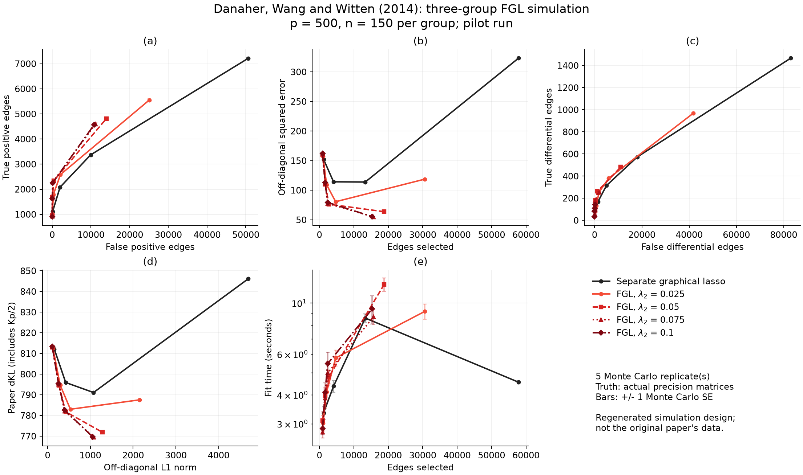

# Checked simulation results

The `figure2-pilot/` folder contains a completed five-replicate run at the
paper's dimensions, **p=500, n=150 per group, K=3**, using seed 2014. Four
sparsity penalties and four fusion penalties, together with zero fusion,
give **100 fits**. These are results for the regenerated population described
in [the protocol](../README.md), not the original authors' data. The full
100-replicate, 6,500-fit profile is implemented but has not been run here.

At sparsity penalty `lambda1=0.175`, the means and Monte Carlo standard
errors are:

| Method | Fusion penalty | Off-diagonal SSE | Paper dKL |
|---|---:|---:|---:|
| Separate graphical lasso | 0 | 113.92 ± 0.82 | 791.11 ± 0.41 |
| FGL | 0.025 | 80.66 ± 0.74 | 783.01 ± 0.39 |
| FGL | 0.05 | 76.43 ± 0.78 | 781.82 ± 0.39 |
| FGL | 0.075 | 77.67 ± 0.76 | 782.13 ± 0.38 |
| FGL | 0.1 | 79.42 ± 0.74 | 782.67 ± 0.37 |

FGL improves estimation over separate fits at these settings. This pilot
does not establish a general ordering or reproduce the paper's numbers.
For comparison, [the paper's Table 1](https://pmc.ncbi.nlm.nih.gov/articles/PMC4012833/#T1)
reports dKL 774 for FGL at `(0.175, 0.025)` over its original 100 data sets;
the regenerated five-replicate result is 783.01. The population, original
random seeds and Monte Carlo sample size differ.

Every fit converged. The largest relative proximal fixed-point residual
was **1.084e-7**, below the example's `1e-5` acceptance threshold. The
population's generating graphs have 490, 441 and 392 edges; the actual
precision matrices have 12,165, 10,940 and 9,715 entries above `1e-8` in
their strict lower triangles, reflecting the printed covariance
transformation's extra precision entries. Twelve non-positive-definite
block draws were rejected. These regeneration choices are explicit in the
protocol and metadata.

[The second plot](figure2-pilot/figure2_generating_graph.png) evaluates
selection against the sparse generating graph. Both plots are also saved
as SVG. `replicates.tsv` and `summary.tsv` contain all fitted points and
their means/standard errors; `metadata.txt` and `dependencies.txt` record
the recipe and software versions. Wall-clock times were measured locally
alongside validation work and are not an isolated performance benchmark.

`jgl_reference.tsv` is a **separate six-fit numerical check**, using the
quick configuration (p=50, n=40), against the pinned JGL 2.3.2 R code on
identical observations. Across those six fits, the largest entrywise
difference was `3.758e-4` and the largest relative objective difference
was `4.810e-10`. The R solver used its published `1e-5` stopping tolerance;
the Julia fits used the stricter tolerances recorded in the example.

The recreation commands for both runs are in the protocol. Tests passed
on Julia 1.10.12 and 1.13.2: 1,454 package checks, including the simulation
generator, scaling, metrics and Monte Carlo summaries. This result folder
is retained evidence; new runs write to the ignored `output/` folder.
